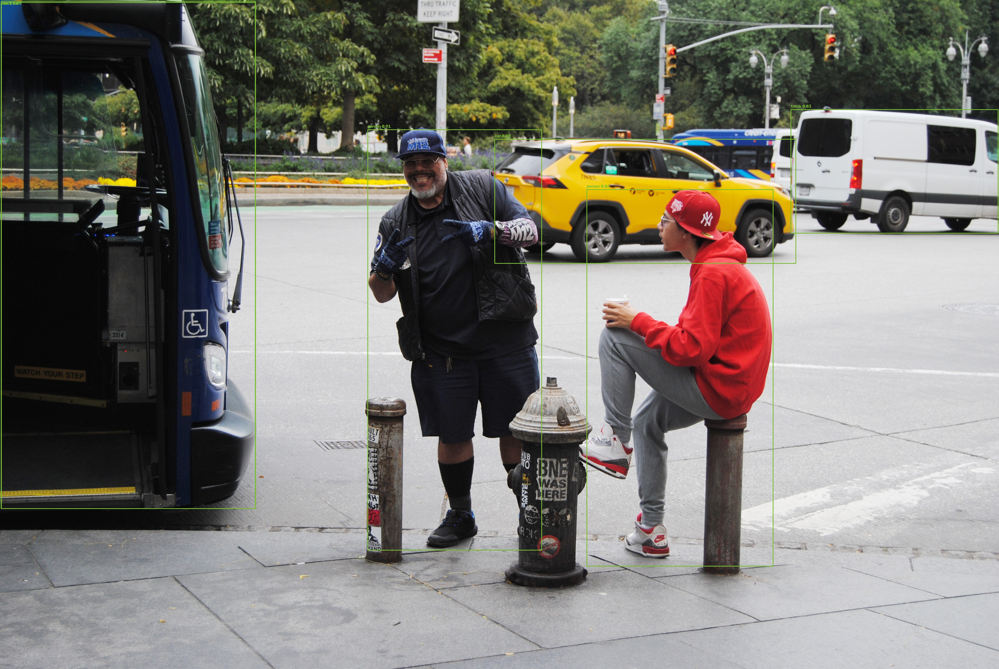

# AI-Powered Real-Time Object Detection and Tracking

A beginner-friendly portfolio project using Python, OpenCV, PyTorch through Ultralytics, YOLO and ByteTrack. It includes a Streamlit dashboard for image, video and local webcam input, annotated output, basic counts, runtime measurements and CSV export.

> This is an educational prototype. It has not been validated for production or for safety-critical use.

## Features

- Six dashboard views: Overview, Image Detection, Video Detection, Live Camera, Analytics and About.
- Configurable local YOLO weights, confidence threshold and COCO class filter.
- Persistent within-session object IDs with the Ultralytics ByteTrack tracker for video and camera frames.
- Bounding boxes, class labels, confidence values and track IDs.
- Frame level and per-class counts, inference latency, total processing duration, optional horizontal line crossing counts.
- Annotated MP4 and analytics CSV downloads for processed video; CSV for live camera sessions.
- Input extension checks and graceful messages for corrupt media, missing weights, unavailable camera and output codec problems.
- Polished dark dashboard styling and a licensed sample image with an annotated inference result in `reports/`.

## Project structure

```text
app.py
src/
  analytics.py       # pure count and CSV row helpers
  detector.py        # lazy model loading and output normalization
  validation.py      # media extension validation
  video.py           # tracking loop, drawing and output video
tests/
  test_analytics.py
  test_detector.py
  test_validation.py
models/               # put local weights here (ignored by Git)
data/samples/         # optional sample media
reports/              # optional local exports
LICENSE               # MIT for this repository's original code
requirements.txt
README.md
.gitignore
```

## Windows setup

Use Python 3.10 or 3.11. In PowerShell, from this project directory:

```powershell
py -3.11 -m venv .venv
.\.venv\Scripts\Activate.ps1
python -m pip install --upgrade pip
pip install -r requirements.txt
```

PyTorch installation can vary by Windows, Python version and CUDA version. If the PyTorch wheel selected by the dependency resolver does not match your machine, follow the current official PyTorch installation selector, then install the remaining requirements. CPU operation is supported by the libraries but may be slow.

### Model weights

The application does not download weights automatically. Put an Ultralytics-compatible `.pt` checkpoint at `models/yolo11n.pt`, or set a path for the current PowerShell session:

```powershell
Invoke-WebRequest -Uri "https://github.com/ultralytics/assets/releases/download/v8.3.0/yolo11n.pt" -OutFile "models/yolo11n.pt"
$env:YOLO_MODEL_PATH = "C:\path\to\your\weights.pt"
```

The default is `models/yolo11n.pt`. The checkpoint must be compatible with your installed Ultralytics version. Review the model card and license for the particular weights you choose.

## Run

```powershell
streamlit run app.py
```

Open the local address Streamlit prints. A camera index refers to a camera on the computer running Streamlit; a remote browser cannot pass its own webcam to the server through this OpenCV capture path. Check Windows camera permissions if the local camera cannot open.

## Tests

```powershell
python -m pytest -q
```

Tests are deliberately independent of downloaded weights and hardware: they cover media-name validation, output normalization, and analytics calculations.

## Sample image and example result

`data/samples/sample_bus_staff.jpg` is a CC BY 4.0 image by LR.127 from Wikimedia Commons; attribution and the source link are in `data/samples/ATTRIBUTION.md`. `reports/sample_bus_staff_detected.jpg` is the YOLO11n output generated by this app at confidence 0.25, using the person, car, bus and truck class filters. It is a worked example, not a benchmark. To recreate it, upload the sample in Image Detection. The original image is included for reproducibility.



## Hardware and expected performance

CPU is sufficient to try the application; a compatible CUDA GPU may improve throughput. Actual speed depends on checkpoint size, input resolution, device, codec, video length and background load. The app displays observed timings for each run. No benchmark is claimed in this repository. Webcam processing is synchronous and limited to the selected frame count, so it is a demonstration rather than a low-latency streaming service.

## Important limitations

- Supported object labels come from the chosen checkpoint; the dashboard filter currently assumes the standard 80 COCO class ordering.
- Tracking IDs are local track associations, not identities. They can reset, switch or fragment when objects are occluded or leave view.
- The optional crossing metric counts each observed track ID once after its box center reaches a horizontal threshold. It does not infer direction, reliably handle an object entering already beyond the line, or deduplicate a reappearing object.
- Media extensions are checked, then OpenCV attempts decoding. Some codecs and container variants may not work on all machines.
- The dashboard keeps the most recent run's analytics in Streamlit session state; it is not a database or multi-user job system.
- Validate accuracy, throughput, security, privacy, accessibility and failure behavior with representative data before any real deployment.

## Licensing and ethical use

The MIT license in `LICENSE` applies to the original project code in this repository. It does not replace or override the separate licenses for dependencies, Ultralytics, the downloaded YOLO checkpoint, or sample media. Check the terms for each component before redistribution or commercial deployment; obtain appropriate legal review where needed. Use only with proper notice, consent where required, data minimization and a valid legal basis. Do not use this project for facial recognition, identity recognition, covert surveillance or consequential decisions about people.

## Interview concepts to explain

1. What confidence threshold and non-maximum suppression do, and how changing a threshold affects precision/recall.
2. How YOLO turns an image into object candidates and why pretrained weights need domain validation.
3. Detection versus tracking; how ByteTrack associates boxes across frames and why IDs are not identities.
4. Coordinate systems, bounding boxes, confidence scores and class filters.
5. Video capture/writer lifecycle, codecs, frame rate and why resources must be released in `finally` blocks.
6. Inference latency versus end-to-end processing duration, and how to benchmark without misleading comparisons.
7. CPU/GPU tradeoffs, model size, image resolution and batching.
8. Unit tests with mocked model outputs versus integration tests that require actual weights and media.
9. Data privacy, model and dependency licensing, evaluation metrics and deployment monitoring.
